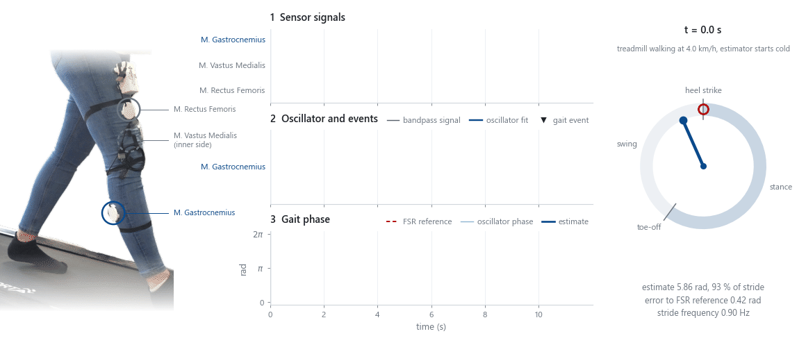
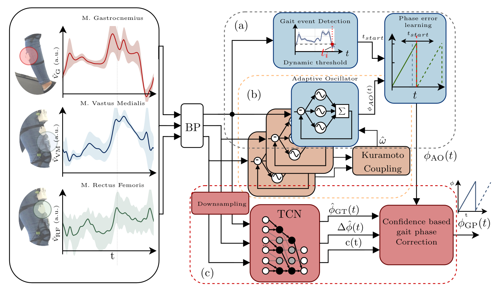
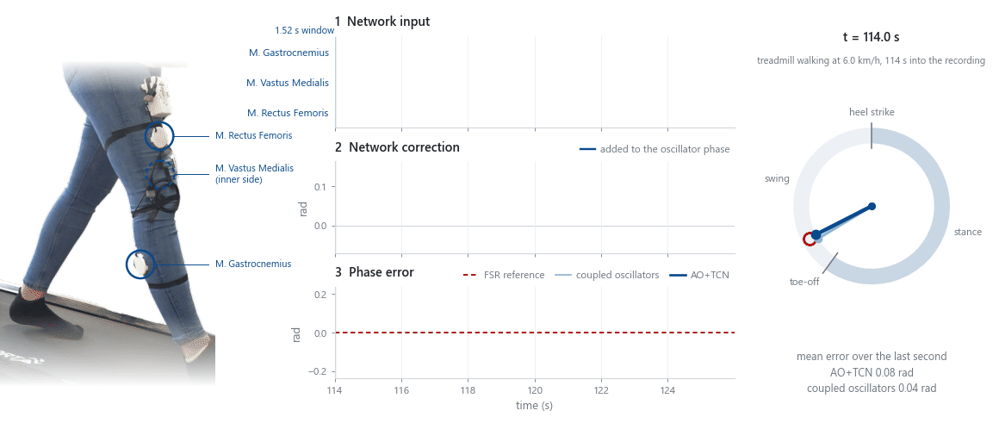

# trousers-ferroelectret-gait-phase

[](#installation)
[](LICENSE)
[](#citation)
[](embedded/README.md)

Continuous gait phase from textile-integrated ferroelectret sensors: an adaptive oscillator,
a coupled-oscillator variant, a causal temporal convolutional network and their hybrid, with
the parameters, network weights and scripts that reproduce the article's results.

<picture>
  <source media="(prefers-color-scheme: dark)" srcset="docs/media/ferro_to_phase_dark.gif">
  
</picture>

*The single-sensor AO starting cold on the first 12 s of an evaluation recording at 4.0 km/h,
in real time. The oscillator learns the M. Gastrocnemius waveform within a few strides (2).
Each detected negative peak, marked by the flashing sensor, corrects the phase, and the
estimate locks onto the FSR reference within four to five strides (3).*

Code for the article

> J. Seiler, M. Suppelt, R. Wilhelm, P. Beckerle, M. Kupnik,
> "Adaptive Continuous Gait Phase Estimation from Textile-Integrated Ferroelectret Sensors,"
> under review at *Bioinspiration & Biomimetics* (volume, article number and DOI to be added on publication).

## How it works

Three ferroelectret force-myography sensors sewn into elastic jeans over the M. Gastrocnemius
(G), M. Vastus Medialis (VM) and M. Rectus Femoris (RF) feed four estimators of continuous gait
phase:



| configuration | modules in the diagram | what it does | paper section |
| --- | --- | --- | --- |
| **AO** | (a) | single adaptive oscillator on the G channel, adaptive-threshold event detector, event-driven phase error learning (after Yan et al. 2017) | 2.3 to 2.5 |
| **C-AO** | (a) + (b) | one oscillator per channel, frequencies pulled toward their quality-weighted mean (Kuramoto-type consensus, κ = 0.25); events and correction on G only | 2.7 |
| **TCN** | (c) | stand-alone causal dilated TCN (7 layers, 48 filters, kernel 5, 167-sample window at 110 Hz) predicting the absolute phase | 2.8 |
| **AO+TCN** | (a) + (b) + (c) | hybrid: the multi-head TCN predicts an additive correction to the C-AO phase, an absolute phase and a confidence, combined by a confidence-weighted circular blend | 2.8 |

<picture>
  <source media="(prefers-color-scheme: dark)" srcset="docs/media/hybrid_dark.gif">
  
</picture>

*The hybrid AO+TCN on 12 s at 6.0 km/h, later in the same recording, which the network never
saw in training. Here the coupled oscillators lag the FSR reference by about 0.11 rad. From the
last 1.52 s of the three signals (1), the network adds about 0.08 rad to the oscillator phase
(2) and halves the phase error (3). This window shows the correction at its clearest. The
averages follow below.*

## Results

On five treadmill recordings (4.0 to 6.7 km/h) of one participant in two sessions:

- **AO:** continuous MAE of 0.158 rad, about 2.5 % of the stride, and no re-tuning between
  sessions.
- **AO+TCN:** per-stride MAE of 0.108 rad instead of 0.163 rad for the AO, and a heel-strike
  timing error of 1.50 % instead of 2.19 % of the stride duration.
- **TCN:** lowest error on its training recordings, but it degrades on the other three.
- **Teensy 4.1:** the AO takes 10 µs per 330 Hz sample, and the complete hybrid runs at 110 Hz
  on 74 % of one core ([`embedded/RESULTS.md`](embedded/RESULTS.md)).

Figures, statistics and the limits of a single participant are discussed in the article.

## Installation

Python 3.10 or newer.

```bash
git clone https://github.com/TUDA-MUST/trousers-ferroelectret-gait-phase.git
cd trousers-ferroelectret-gait-phase
python -m venv .venv
source .venv/bin/activate          # Windows: .venv\Scripts\activate
pip install -r requirements.txt
```

The oscillator path needs only numpy and scipy; the networks need PyTorch (CPU is sufficient).
Tested with Python 3.12.3, numpy 1.26.4, scipy 1.16.3 and torch 2.5.1.

## Data

The recordings are deposited on TUdatalib under CC BY 4.0 and become publicly accessible when
the article is published. Until then, they are available from the corresponding author on
reasonable request.

> Wearable Ferroelectret Force Myography Dataset for Gait Phase Estimation,
> DOI [10.48328/tudatalib-2246](https://doi.org/10.48328/tudatalib-2246)

Download and extract the archive. The scripts take the extracted folder (the one that contains
`data/`, or a folder above it) and read the sensor-unit files in `data/`. Five of the eight
recordings are evaluated: the S1 speed ramp, the S1 constant-speed recordings at 6.7 and
4.5 km/h, and both S2 speed ramps. The three S1 recordings at 4.0, 5.0 and 6.0 km/h were made
with an earlier heel FSR and are not evaluated in the paper.

## Reproducing the paper

```bash
python scripts/reproduce.py --data path/to/Ferroelectret_FMG_Dataset
python scripts/reproduce.py --data path/to/Ferroelectret_FMG_Dataset --out results   # also write CSVs
```

The oscillators run sample by sample in plain Python, as they would in a real-time loop, so a
full run takes about three to four minutes (five recordings, 426,544 samples at 330 Hz, four
oscillators each). `--out` writes the per-stride MAE, the matched heel-strike offsets and the
per-recording metrics as CSV files. `--device cpu|cuda` selects the device for the networks.
All 40 compared values agree with the article at the printed precision, and the script exits
with status 0 when they do.

<details>
<summary>Expected output (abridged)</summary>

```text
Headline numbers
                                                      paper    release      n
  per-stride MAE, pooled (rad)       AO               0.163     0.163   1257  ok
  per-stride MAE, pooled (rad)       C-AO             0.156     0.156   1257  ok
  per-stride MAE, pooled (rad)       AO+TCN           0.108     0.108   1257  ok
  per-stride MAE, pooled (rad)       TCN              0.171     0.171   1257  ok
  continuous MAE, recording mean (rad) AO             0.158     0.158      5  ok
  continuous RMSE, recording mean (rad) AO            0.290     0.290      5  ok
  continuous MAE, recording mean (rad) AO+TCN         0.112     0.112      5  ok
  continuous RMSE, recording mean (rad) AO+TCN        0.220     0.220      5  ok
  temporal MAE, pooled (% stride)    AO                2.19      2.19   1249  ok
  temporal MAE, pooled (% stride)    AO+TCN            1.50      1.50   1259  ok
  held-out windows, per-stride MAE (rad) AO            0.081     0.081    151  ok
  held-out windows, per-stride MAE (rad) AO+TCN        0.063     0.063    151  ok
  held-out windows, per-stride MAE (rad) TCN           0.049     0.049    151  ok

Table 4: per-stride MAE by training exposure (rad)
  split                      n              AO          AO+TCN             TCN   (paper / release)
  training recordings      649   0.127 / 0.127   0.069 / 0.069   0.051 / 0.051
    held-out windows       151   0.081 / 0.081   0.063 / 0.063   0.049 / 0.049
  evaluation recordings    608   0.203 / 0.203   0.150 / 0.150   0.298 / 0.298
  S1, evaluation           448   0.216 / 0.216   0.151 / 0.151   0.353 / 0.353
  S2, evaluation           160   0.165 / 0.165   0.147 / 0.147   0.144 / 0.144
```

The script also prints the single-sensor results of Table 2 by session and the pooled temporal
errors of all four configurations.

</details>

<details>
<summary>Exactness and what is not included</summary>

The release was checked against the analysis code used for the paper, recording by recording
and array by array. From the dataset files, the bandpass signals, the FSR reference, the AO and
C-AO phases and events, and the network input windows are bit-identical; so are all 5,028
per-stride errors and 5,019 matched heel-strike offsets with the networks on CUDA. On the CPU
the network outputs differ from the CUDA values by less than 2e-5 rad per sample (float32
convolution order), which changes no printed digit.

Two details of the evaluation are reproduced on purpose:

- **Resample first, then trim.** Each recording is polyphase-resampled to 330 Hz as a whole,
  then cut to the analysis window (`trim_start_s`, `trim_end_s` in `params/recordings.json`).
  The `apply_trim` option of the dataset's own loader trims at the native rate and gives
  slightly different signals.
- **First sample of the S2 files.** The evaluation read the session-2 source files with a loader
  that skipped their first line as a header, although these files have none. The published CSVs
  keep that sample. `drop_first_sample` in `params/recordings.json` reproduces the evaluation
  exactly; `--keep-first-sample` runs on the complete files, which shifts the resampling grid
  by one native sample. The pooled per-stride and continuous values stay the same at three
  decimals; other values that include S2 strides move by up to 0.005 rad (S2 stride-time MAE
  0.172 instead of 0.167 rad, held-out windows AO 0.082 and AO+TCN 0.064 instead of 0.081 and
  0.063 rad) and the AO temporal MAE by 0.01 percentage points.

Not included: the breakdown of the temporal error into steady walking, speed transitions and
the initial window (it detects speed changes from the oscillator frequency), the
gait-initiation and restart analyses, the
statistical tests, and the ablation and leave-one-session-out studies.

</details>

## Using the estimators

```python
import gaitphase as gp
from gaitphase import tcn

params = gp.load_params()
root = gp.find_dataset_root('path/to/Ferroelectret_FMG_Dataset')
rec = gp.load_recording(root, 'Ramp_30s')                  # 330 Hz, trimmed, raw signals in mV
fs, t = rec['fs'], rec['time']
bp = {m: gp.bandpass_from_params(rec['muscles'][m], fs, params) for m in gp.MUSCLES}

ao = gp.run_estimator([bp['G']], t, fs, params)                                    # AO
cao = gp.run_estimator([bp['G'], bp['VM'], bp['RF']], t, fs, params, kappa=0.25)   # C-AO

windows = tcn.network_input(bp['G'], bp['VM'], bp['RF'])
phi_hybrid = tcn.predict_hybrid(tcn.load_model('hybrid'), windows, cao['phase'])   # AO+TCN
phi_tcn = tcn.predict_standalone(tcn.load_model('standalone'), windows, len(t))    # TCN
```

`run_estimator` is causal and processes one sample at a time. The network sees only the past
167 samples at 110 Hz for each output; offline, all windows are evaluated in one batch. For
signals from other hardware, feed bandpass-filtered signals in volts at 330 Hz with the primary
(Gastrocnemius) channel first.

<details>
<summary>Implementation conventions, compared with the equations of the paper</summary>

- The phase error learner state φ_e tracks φ_ref − φ_AO and is added to the oscillator phase:
  φ_GP = (φ_AO + φ_e − φ_ref + φ_off) mod 2π.
- The frequency consensus of the C-AO applies ω_j ← ω_j + κ(ω̄ − ω_j)Δt to each channel, with
  ω̄ = Σ q_j ω_j / Σ q_j and q_j = Σ_n |α_n,j|.
- The event-detector parameters were optimized on the complete S1 speed ramp, including its
  held-out windows; the oscillator parameters only on its first 60 s (22 s at 4.0 and 38 s at
  4.5 km/h).

</details>

## Retraining the networks

```bash
python scripts/train_tcn.py --data path/to/Ferroelectret_FMG_Dataset --kind hybrid --out hybrid.pt
python scripts/train_tcn.py --data path/to/Ferroelectret_FMG_Dataset --kind standalone --out tcn.pt
```

The networks in `weights/` are the paper models: trained on the two 60 s speed ramps with two
70 s windows of each ramp removed, which leaves 42,795 training windows. The windows were meant
to hold out the 4.5 and 5.5 km/h steps but lie on the nominal protocol grid, which starts at
the trim; the trims cut 37.9 s and 11.2 s into the first speed step (`step_onset_s` in
`params/recordings.json`), so the windows span parts of two adjacent steps and every speed
also occurs in training. Their central 40 s are the held-out windows of the paper.

The script rebuilds the 42,795 training windows and trains with the settings of Table 1 (Adam,
OneCycleLR with peak 3e-3, 300 epochs, batch 1024, amplitude scaling 0.05 to 5, 10 % channel
dropout, noise 0.01) and keeps the epoch with the lowest training loss. Seed 0 matches the paper
models' seeds, but GPU training is not bit-reproducible across hardware and library versions:
three training seeds of the hybrid gave pooled per-stride MAEs of 0.100 to 0.108 rad. One
network took about two hours on a workstation GPU. `--no-holdout` trains on the complete
ramps.

## Embedded implementation

`embedded/` holds the plain-C99 port of the estimators (bandpass, AO, event detector, phase
correction, C-AO and exact windowed TCN inference) with a PlatformIO harness for the ESP32 and
the Teensy 4.1, validated in the loop against the Python pipeline. Measured costs are in
`embedded/RESULTS.md`. The TCN weight header in that folder predates the held-out-window
retraining of the paper networks; `embedded/README.md` explains how to regenerate it from
`weights/tcn_hybrid_7L48f.pt`.

## Contents

<details>
<summary>Repository layout</summary>

```text
gaitphase/            Python package
  data.py             load the TUdatalib CSVs, resample to 330 Hz, trim to the analysis window
  preprocessing.py    causal bandpass (0.5-15 Hz), FSR heel-strike reference
  oscillator.py       adaptive oscillator (RK4)
  events.py           adaptive-threshold event detector
  correction.py       phase error learner
  estimator.py        AO and C-AO, sample by sample
  tcn.py              network definitions, windowed inference, AO+TCN blend
  metrics.py          continuous MAE/RMSE, direct MAE, ST-MAE, per-stride MAE, temporal error
params/
  estimator_params.json   optimized parameters of Table 1 at full precision
  recordings.json         the five evaluated recordings: files, channel mapping, FSR thresholds, trims
weights/
  tcn_hybrid_7L48f.pt     AO+TCN network (state_dict, 71,099 parameters)
  tcn_standalone_7L48f.pt TCN network (state_dict, 70,952 parameters)
  tcn_config.json         architecture, training settings, checksums
scripts/
  reproduce.py            runs the four configurations and prints paper vs release values
  train_tcn.py            retrains a network with the paper settings
  make_animation.py       renders the two animations on this page (needs matplotlib and Pillow)
embedded/                 C port for ESP32 and Teensy 4.1 (PlatformIO), see embedded/README.md
docs/media/               README animations, trousers photo and block diagram from the article
```

</details>

## Citation

```bibtex
@article{seiler2026adaptive,
  author  = {Seiler, Julian and Suppelt, Mark and Wilhelm, Ruth and Beckerle, Philipp and Kupnik, Mario},
  title   = {Adaptive Continuous Gait Phase Estimation from Textile-Integrated Ferroelectret Sensors},
  journal = {Bioinspiration \& Biomimetics},
  year    = {2026},
  volume  = {TBD},
  doi     = {TBD},
  note    = {Under review}
}
```

Please also cite the dataset (DOI 10.48328/tudatalib-2246) when you use the recordings.

## License

The code and the network weights are released under the MIT License (see `LICENSE`). The
dataset is licensed separately under CC BY 4.0.

## Acknowledgments

Funded by the Deutsche Forschungsgemeinschaft (DFG), grant no. 450821862, within Research
Training Group 2761.

<details>
<summary>Version history</summary>

- 1.0.1 (November 2026): measured speed-step onsets of the three ramps (`step_onset_s` in
  `params/recordings.json`) for the steady and transition segments, and the held-out windows
  defined as the central parts of the windows removed from network training. The networks,
  parameters and every reproduced value are unchanged. The Table 2 reference in
  `scripts/reproduce.py` now matches the article, so all 40 compared values agree.
- 1.0.0 (2026): release accompanying the revised article. It replaces the initial release
  (packages `ao_gait_phase` and `tcn_hybrid`, May 2026), which remains in the git history.

</details>
